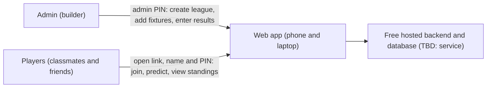
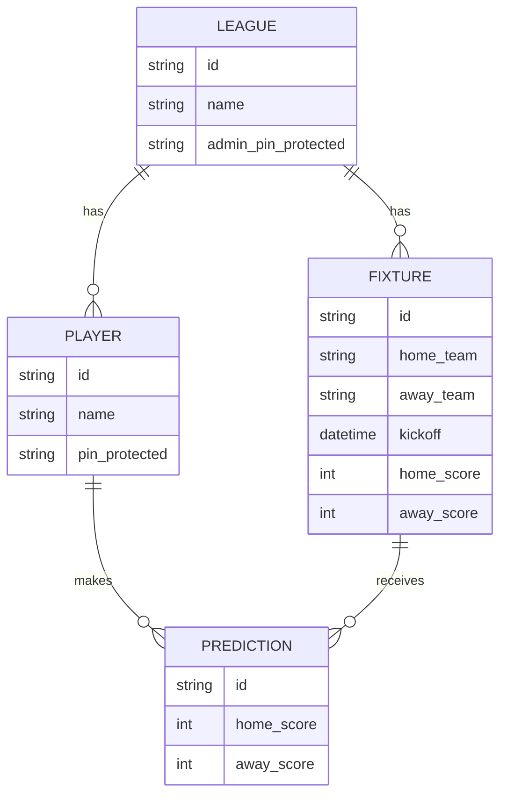

# Studio Module Test Project: architecture

## Tier

- TBD: the tier is not chosen yet. The Design coach conversation has not happened, so nothing is recorded.
- Working suggestion, to confirm: a free hosted backend, the second tier. A static page or PWA alone is not enough, because players on different phones and laptops must see the same league, predictions and standings, and the kickoff cutoff and admin PIN checks cannot be trusted if they only run in the browser.
- Serverless functions or a server of his own are heavier than this needs. v1 has no sports data API, no accounts and no background jobs, and the $0 constraint rules out a server he must pay for.
- TBD: confirm the tier once the hosting and storage services are chosen.

## Stack

- Client: a web app that works on phone and laptop, opened from a shared link. TBD: choose the framework, or plain HTML, CSS and JavaScript.
- Backend and storage: a free hosted backend with a database. TBD: choose the service.
- Auth: no accounts. Players use a name and a PIN. The admin uses an admin PIN set when the league is created.
- Scoring and ranking: 3 points for an exact score, 1 for the right outcome, 0 otherwise. Tied players share a rank. TBD: decide whether this is calculated when read or stored when a result is entered.
- Live updates: standings should reflect new results (story S6). TBD: decide whether the page refreshes on its own or the player reloads. He wants realtime skills, so this is worth deciding on purpose.
- Build tool: Claude Code.
- TBD: PIN length and format (S1), and how PINs are stored (S2).

## Context diagram

- No sports data API. Results come only from the admin.

## Data

- A player's name is unique within a league (S1). One prediction per player per fixture, and a new one replaces the old before kickoff (S3).
- Fixture scores stay empty until the admin enters the result.
- Points and ranks are derived from predictions and results.
- The field names are a first sketch from the stories, not a decision.
- TBD: how PINs are stored, so the `_protected` fields are placeholders.
- TBD: whether kickoff times need a time zone decision, since players may not share one.

## Hosting and cost

- Target: $0, free tiers only.
- TBD: choose hosting and storage, then list each service's free-tier limits and confirm v1 stays under them (see docs/nfrs.md).
- TBD: how many players and leagues v1 should handle. Nothing is confirmed yet, so no limits are set.
- Manual results avoid paying for sports data.
- TBD: check that free tiers do not pause or delete an idle project, which could break a league mid-season.

## Risks

- Cost: free tiers may have limits or change. The hosting choice is not made yet.
- Pain is unproven, and only the builder is confirmed as a user. TBD: ask 3 classmates whether they would join a league.
- Admin PIN: if it is forgotten, there is no reset in v1. TBD: decide storage and what happens.
- Trust: with no accounts, anyone with the link and a name could try PINs. TBD: decide whether a short PIN needs attempt limits.
- Kickoff cutoff: it must be enforced on the backend, not only in the page, or players could predict late.
- Reachability: TBD: find out which phones and browsers classmates use, and how they connect.
- Manual results depend on the admin entering them promptly. Standings will lag if he does not.

## Decisions to record

- ADR: Tier and hosting choice (free hosted backend, and which service).
- ADR: Database and storage choice.
- ADR: How PINs are stored, and what happens if the admin forgets theirs.
- ADR: How standings update (calculated on read or stored, and refresh method).
- ADR: Manual result entry instead of a sports data API (already a v1 non-goal, worth recording with its reason).
- ADR: Where the kickoff cutoff is enforced.
